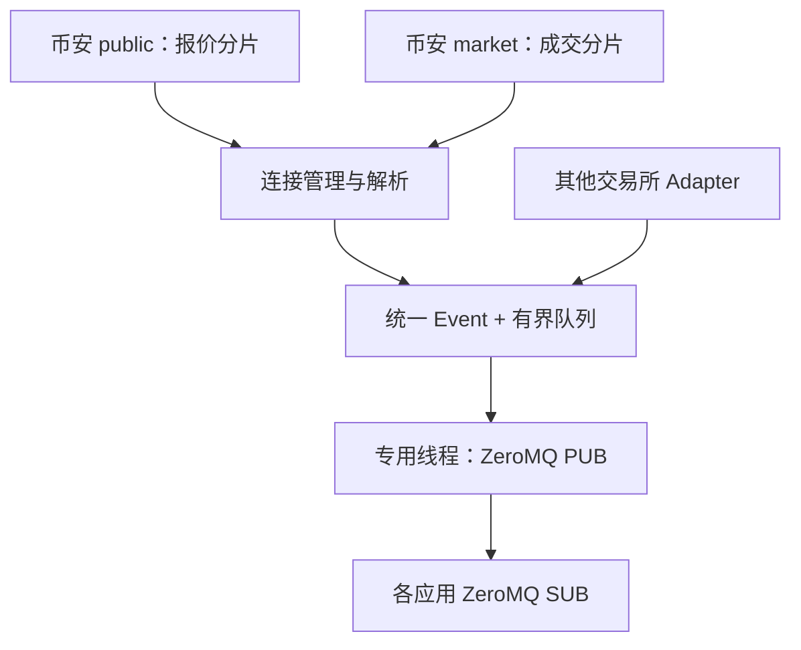

# Marketpipe：Go 行情接入与 ZeroMQ 分发

一个可以编译运行、便于扩展的行情网关。首先接入币安 **USDⓈ-M（U 本位合约）**，通过标准 ZeroMQ PUB/SUB 将行情发给不同语言、不同进程的应用。

当前实现买卖一报价 `bookTicker` 和聚合成交 `aggTrade`。后者是交易所聚合成交，不是每一笔原始撮合成交。不包含下单、L2 本地订单簿、REST 补历史、持久化、动态订阅或双活无缝切换。默认接入 BTCUSDT / ETHUSDT，可修改配置增加交易对。

## 快速运行

### Docker

```bash
docker compose up --build -d
docker compose logs -f marketd
```

另开终端订阅：

```bash
python -m pip install -r examples/requirements.txt
python examples/subscriber.py
```

默认只映射本机 `5556`（ZeroMQ）与 `8080`（健康检查）。容器里的监听地址为 `0.0.0.0`，宿主机映射为 `127.0.0.1`。修改 `configs/docker.json` 后用 `docker compose restart marketd` 重启生效。

### Linux / macOS 原生

需要 Go 1.23+（建议使用维护中的稳定版本）、C 编译器、libzmq 开发头文件和 pkg-config。这里选用原生 libzmq 的成熟 PUB/SUB 实现，因此 **不是纯 Go 单文件交叉编译方案**。

```bash
# Debian / Ubuntu
sudo apt-get update
sudo apt-get install -y build-essential pkg-config libzmq3-dev

# macOS，替代上面两行
brew install zeromq pkg-config

go mod download
go build -o bin/marketd ./cmd/marketd
./bin/marketd -config configs/local.json
```

Go 订阅端：

```bash
go run ./cmd/subscriber -endpoint tcp://127.0.0.1:5556 \
  -topic 'md.v1.binance.usdm.BTCUSDT.quote|'
```

Node.js 订阅端：

```bash
npm install zeromq
node examples/subscriber.mjs
```

跨平台指使用标准 ZMTP 协议互通：Linux/macOS/Windows 上的 Python、Node.js、C++、C# 等应用均可使用对应 ZeroMQ 库连接。Go 网关推荐部署在 Linux，macOS 可本机构建；Windows 可用 Docker Desktop/WSL2。Windows 原生 Go 网关需要自行配置 CGO 和 libzmq，未在本次交付中验证。Node 示例也未在本次环境运行。

跨主机时，将发布端改为 `tcp://0.0.0.0:5556`，客户端连 `tcp://服务器IP:5556`，并相应调整 Docker 端口映射。建议使用受控内网/VPN，当前协议未实现 CURVE 认证或加密。浏览器页面不能直接连接 ZeroMQ TCP，需要另加 WebSocket 桥接服务。本机 Unix 应用也可配置 `ipc:///tmp/marketpipe.sock`。

## 架构与扩展点



| 目录 | 职责 |
|---|---|
| `pkg/market` | 公共 Event、Quote、Trade、Sink、Adapter 接口 |
| `internal/binance` | 币安分流、分片、字段校验与标准化 |
| `internal/stream` | WebSocket 生命周期、心跳、重连与拨号限速 |
| `internal/hub` | 序号、进程实例标识、有界队列与丢弃统计 |
| `internal/publisher` | 固定 OS 线程持有 libzmq socket，JSON 二帧分发 |
| `internal/monitor` | 健康检查、分片状态、Prometheus 文本指标 |
| `cmd/marketd` | 配置、组件装配、退出与排空 |
| `cmd/subscriber`、`examples` | Go、Python、Node.js 消费示例 |

扩展新交易所只需实现以下接口，并加入 `cmd/marketd` 的 `adapters` 列表：

```go
type Adapter interface {
    Name() string
    Run(context.Context, Sink) error
}

type Sink interface {
    Emit(Event) bool
}
```

`Run` 内维护自己的连接/订阅，构造统一 Event 后调用 `sink.Emit(e)`；返回前必须退出并回收自己启动的 goroutine。可复用 `internal/stream.Manager`，如果该交易所需要登录、订阅 ACK 或其他心跳协议，可实现自己的连接管理。`Emit` 返回 false 表示入口队列满；不能从接入线程阻塞重试。传入的 Event 及其指针内容在提交后不得再修改。新适配器应只接受已配置的有限 topic，并为断线后的连接生成新的 `SourceSession`。

## 连接稳定性

- 报价连接 `/public/stream`，成交连接 `/market/stream`，不混用端点。
- 每连接默认最多 128 个 stream，低于交易所文档的 1024 上限。当前每个 channel 单独分组，共 `2 × ceil(交易对数 / 128)` 条连接（两类都启用时）。过长 URL 会在启动前报错，可减小分片大小。
- 每条连接一个读取循环，一个控制循环；不为每个 tick 新建 goroutine。
- 收到服务端 Ping 回应原始 payload 的 Pong；同时每 30 秒发 Ping，读超时 90 秒。握手和控制帧写入也有超时。
- 各连接独立指数退避并加入随机抖动，默认 1–30 秒；连续存活一分钟才重置退避。所有分片共用 250ms 拨号间隔，避免同时重连。
- 默认 23 小时 50 分钟前后主动换连接，提前量有抖动。属于断开再连接，**不承诺无缝、不丢上游数据**。
- 最大单条 WebSocket 消息默认 1MiB；坏 JSON、错误控制响应、非预期交易对/类型都会触发错误指标和重连，不会被当成有效行情。
- 只使用 URL 静态订阅，没有运行时增删订阅消息。更新 symbols/channels 需重启。交易所返回 HTTP 拒绝、区域限制或无效交易对时，查看日志与 `/status`；指数退避不会修复访问权限或配置问题。
- 优雅退出顺序：取消输入 → 关闭并回收连接 → 关闭队列 → 最多 3 秒排空 → 关闭 socket 与 HTTP。libzmq 设置 linger=0，退出时不会无限等待消费者。

这是一套有明确故障边界的基础服务，不能仅凭重连机制宣称具备生产 SLA。部署前仍应在实际网络、交易对数量和消费者负载下做持续运行及延迟测试。

## 线协议

每条 ZeroMQ 消息**固定两帧**，不是用空格分隔的一条字符串：

| 帧 | 编码 | 内容示例 |
|---|---|---|
| 0 | UTF-8 | `md.v1.binance.usdm.BTCUSDT.quote\|` |
| 1 | UTF-8 JSON | 下方 Event |

```json
{
  "schema": 1,
  "instance": "a0e6d734cfbb4a65980b1e9895f0fdb2",
  "seq": "123",
  "exchange": "binance",
  "market": "usdm",
  "symbol": "BTCUSDT",
  "kind": "quote",
  "source_session": "15887b68aba24a9c80b7aeea3b5d670d",
  "source_id": "9007199254740993",
  "event_time_ms": 1700000000001,
  "trade_time_ms": 1700000000000,
  "receive_time_ns": "1700000000002123456",
  "quote": {
    "bid_price": "60000.12345678",
    "bid_qty": "0.01000000",
    "ask_price": "60000.12345679",
    "ask_qty": "2.00000000"
  }
}
```

上述 JSON 是协议示例，不是实盘抓取。成交 topic 为 `md.v1.binance.usdm.BTCUSDT.agg_trade|`，`kind` 为 `agg_trade`，用 `trade` 代替 `quote`：

```json
{
  "price": "60000.12345678",
  "qty": "0.01000000",
  "side": "sell",
  "first_trade_id": "10",
  "last_trade_id": "12"
}
```

`side` 是主动成交方方向；币安 `m=true` 表示买方是 maker，所以主动方为 sell。报价与成交是独立事件，服务不把不同时刻的数据拼接成一个“同时更新”的 tick。

| 字段 | 精确定义 |
|---|---|
| `schema` | 线协议版本，当前为 1 |
| `instance` | 网关进程实例标识，进程重启改变 |
| `seq` | 同一 instance 下，每 topic 从 1 递增；在入口队列丢弃之前分配 |
| `source_session` | 上游连接实例，每次重连改变 |
| `source_id` | quote 对应 `u`；agg_trade 对应 `a`；保留为字符串 |
| `event_time_ms` | 交易所事件时间 E，毫秒 |
| `trade_time_ms` | 交易所交易时间 T，毫秒 |
| `receive_time_ns` | 网关完成 WebSocket ReadMessage 时的本机 Unix 纳秒时间 |
| 价格、数量 | 原样十进制字符串，无 float64 转换 |

ZeroMQ 使用前缀订阅。订阅 `md.v1.binance.usdm.` 接收全部 U 本位行情；订阅 `md.v1.binance.usdm.BTCUSDT.` 接收该交易对全部类型；完整 topic 最后的 `|` 用于准确限定一个类型。没有跨连接/跨 topic 的全局事件时间排序；同一上游 stream 只属于一个分片，服务保留该 stream 到达队列的次序。

Node.js 对 seq、纳秒时间使用 BigInt，价格用十进制库；Python 可使用 int 和 Decimal。跨机计算延迟前需要校准主机时钟；`receive_time_ns` 不是内核网卡时间戳。

## 背压、丢失与恢复语义

**ZeroMQ PUB/SUB 是实时广播，不是可靠消息队列。**

1. Go 入口队列默认 32768 条，满时丢弃新到达事件并增加 `marketpipe_ingress_dropped_total`。不会阻塞 WS 读取，也不会无限增长内存。序号先分配再入队，后续同 topic 事件可显示缺口。
2. libzmq 的 SNDHWM 默认每订阅者 10000 条。慢订阅者队列满后，PUB 丢弃发给该订阅者的消息，不等待它；其他订阅者继续接收。实际队列容量受 libzmq/TCP 缓冲影响，HWM 不是严格的字节内存上限，总内存也随订阅者数量变化。
3. PUB 的 send 成功只表示调用成功，不能证明任何订阅者收到，也不能统计 libzmq 对每个慢订阅者的丢弃。因此指标叫 `publish_calls_total`，不会把它写成“送达数”。
4. 首次订阅有 slow joiner 窗口；新订阅者没有历史快照或 replay；断线期间不补发。首次消息之前、最后一条消息之后的缺失无法仅凭 seq 检测。
5. seq 检测的是网关入口以后的缺口；上游断线期间根本没接到的数据不会占用 seq。必须结合 `source_session`、心跳与行情时间检查。报价的源 update ID 不能要求逐个 +1；本项目不自动按源 ID 去重或推断所有上游缺口。
6. 序号跳变或源连接改变时，报价消费者应暂时标记不新鲜，等待新报价；成交统计消费者应记录不完整区间。如果需要完整成交日志，需要额外设计 WAL/持久化、补数和 ACK/replay，保留 ZeroMQ 作为实时出口。

每秒还有 `md.v1.system.gateway.ALL.heartbeat|`，包含各分片连接状态。示例同时订阅此 topic。心跳也经过有界队列并可能丢失，不是可靠控制通道。实际策略应按每个 symbol 的最后到达时间设置超时，并在网关重启、上游重连和数据缺口时执行自己的降级逻辑。

## 运维与测试

```bash
curl http://127.0.0.1:8080/healthz
curl http://127.0.0.1:8080/readyz
curl http://127.0.0.1:8080/status
curl http://127.0.0.1:8080/metrics

python -m pip install -r examples/requirements.txt
go test -race ./...
go vet ./...
go test ./internal/binance -run '^$' -bench BenchmarkDecodeQuote -benchmem
```

`/healthz` 只检查进程 HTTP 存活。`/readyz` 要求发布端已绑定，且每个分片已连接并在本次连接收到至少一个有效事件；**不保证每个交易对都有新行情**，也不保证消费者收到消息。`/status` 展示各分片最后事件时间、连接标识与错误。生产上应针对连接 down、持续入口丢弃、队列积压和行情陈旧建立监控。日志是结构化 JSON，不打印每条 tick。

测试覆盖精度、主动方向、错误载荷、端点路由、分片、并发序号、队列溢出、静默连接超时、Pong 保活、定时换连接和 Python 跨进程互通。没有 pyzmq 时互通测试会明确 skip；CI 会安装它。`.github/workflows/test.yml` 提供 Linux/macOS 的 race、vet、build 和 TCP 互通测试，随项目提供但本次没有触发远程 CI。

受限环境可执行 `MARKETPIPE_TEST_TRANSPORT=ipc go test -race ./...`，只把 ZeroMQ 互通测试切换为本机 IPC；模拟上游仍使用本机 WebSocket。它不能替代真实部署环境的 TCP 与币安实盘验收。具体本次执行记录见 `VALIDATION.md`。

## 官方依据

接口核对时间：2026-09-05。使用新的路由路径，不依赖旧 URL。

- [Binance WebSocket 连接规则](https://developers.binance.com/en/docs/products/derivatives-trading-usds-futures/websocket-market-streams/Connect)
- [Binance Public：bookTicker](https://developers.binance.com/en/docs/catalog/core-trading-derivatives-trading-usd-s-m-futures/api/ws-streams/public)
- [Binance Market：aggTrade](https://developers.binance.com/en/docs/catalog/core-trading-derivatives-trading-usd-s-m-futures/api/ws-streams/market)
- [libzmq PUB/SUB socket 语义](https://libzmq.readthedocs.io/en/latest/zmq_socket.html)
- [Go libzmq binding](https://github.com/pebbe/zmq4)
